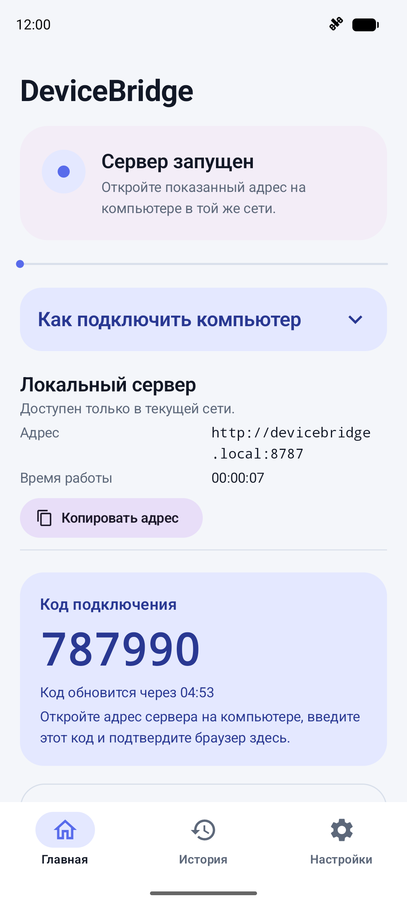
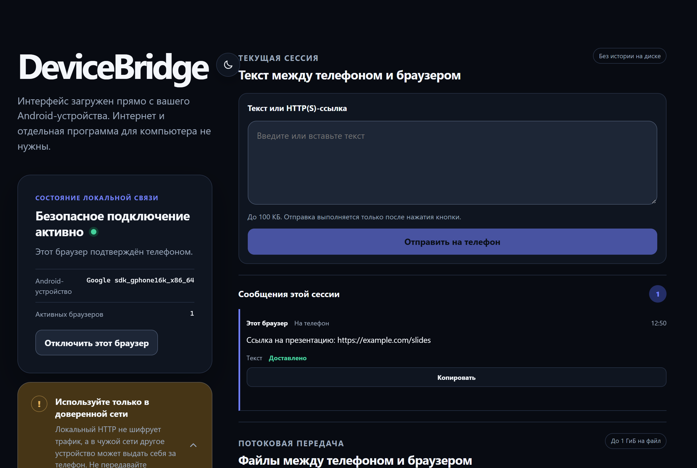

# DeviceBridge

[](https://github.com/giyto/DeviceBridge/actions/workflows/ci.yml)
[](LICENSE)

Передача текста, ссылок и файлов между Android-телефоном и компьютером через браузер. Без облака, аккаунта и интернета: на компьютер ничего не нужно ставить, телефон сам отдаёт страницу по локальной сети.

<p>
  
  &nbsp;
  
</p>

## Как это работает

1. Телефон и компьютер в одной Wi-Fi-сети (или компьютер подключён к точке доступа телефона).
2. В приложении нажимаете «Запустить сервер».
3. На компьютере открываете `http://devicebridge.local:8787`, вводите шестизначный код с экрана телефона и подтверждаете браузер на телефоне.

Дальше вкладка работает сама: переподключается после перезапуска сервера, а запомненный браузер входит без кода до 30 дней.

## Возможности

- **Текст и ссылки** в обе стороны, до 100 КБ: копирование одним нажатием, ссылки открываются.
- **Файлы** в обе стороны, до 1 ГиБ на файл: потоковая передача с проверкой SHA-256, отмена с любой стороны, продолжение прерванной передачи больших файлов.
- **Постоянный адрес по имени** `devicebridge.local` через mDNS: не меняется, когда роутер выдаёт телефону другой IP. Имя можно задать своё, а второй телефон в той же сети сам возьмёт `devicebridge-2`.
- **Защищённый режим (HTTPS)**: телефон создаёт собственный корневой сертификат, ограниченный локальными адресами, и выпускает по нему сертификат сервера.
- **Подтверждение на телефоне**: каждый новый браузер разрешается вручную, прямо из уведомления в том числе. Доверенные браузеры можно отозвать.
- **Локальная история** операций с настраиваемым сроком хранения.
- Плитка в быстрых настройках, автоостановка сервера без подключений, уведомления о входящих файлах и тексте.
- Светлая и тёмная тема, доступность (TalkBack, крупный шрифт, управление с клавиатуры на странице).

## Безопасность в двух словах

- Сервер доступен только в локальной сети и только пока запущен; без подключений он сам останавливается.
- Без кода и подтверждения на телефоне браузер ничего не получит.
- Запросы с чужих адресов и сайтов отклоняются: проверяются Host и Origin.
- В режиме HTTP трафик не шифруется, поэтому в чужой или публичной сети стоит включать защищённый режим.

Подробности — в [техническом задании](docs/technical-specification.md) и [руководстве пользователя](docs/user-guide.md).

## Требования

- **Телефон:** Android 10 (API 29) и новее.
- **Компьютер:** актуальные Chrome или Edge. Проверено на Windows 11.

## Сборка из исходников

Нужны:
- Android Studio или Android SDK с платформой API 37;
- JDK 17 и новее (демон Gradle сам скачает нужный JDK);
- Node.js 22.15+ и npm 10.9+: страница, которую отдаёт телефон, собирается вместе с приложением.

```bash
./gradlew :app:assembleDebug
```

Готовый APK: `app/build/outputs/apk/debug/app-debug.apk`.

### Тесты

```bash
./gradlew :app:testDebugUnitTest :app:lintDebug
```

```bash
cd web && npm ci && npm test
```

Тесты страницы в настоящих Chrome и Edge: `npm run test:compatibility` и `npm run test:visual`. Инструментальные тесты запускаются на эмуляторе или телефоне через `am instrument`.

## Устройство проекта

| Папка | Что внутри |
|---|---|
| `app/` | Android-приложение: Kotlin, Jetpack Compose, Hilt, встроенный сервер Ktor, Room, DataStore |
| `web/` | Страница для браузера: TypeScript и Vite, без фреймворков; собирается в ресурсы приложения |
| `docs/` | Руководство пользователя, техническое задание, отчёты проверок |
| `openspec/` | Спецификации и история изменений (OpenSpec) |

## Лицензия

DeviceBridge распространяется по лицензии [GNU GPL v3.0](LICENSE).
